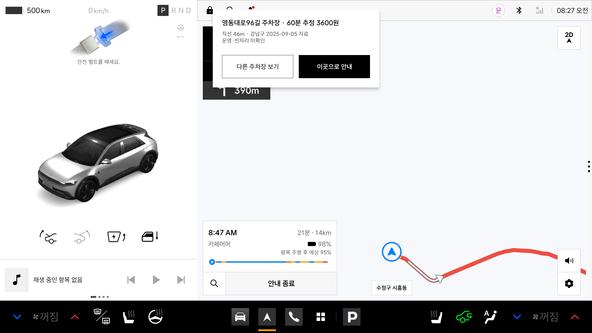
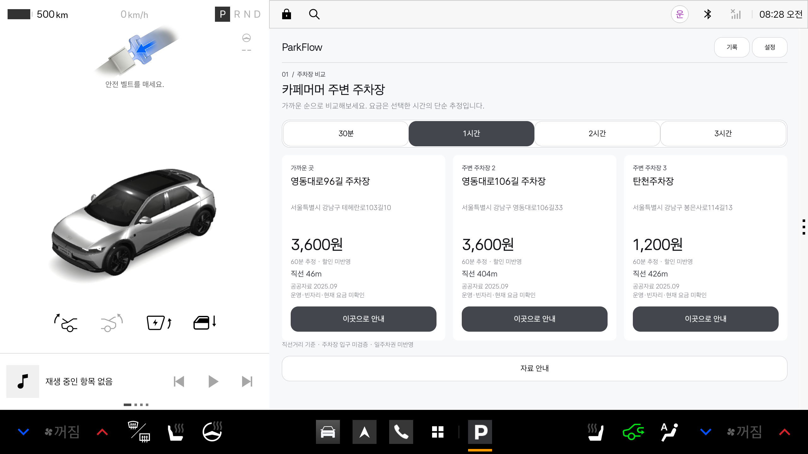
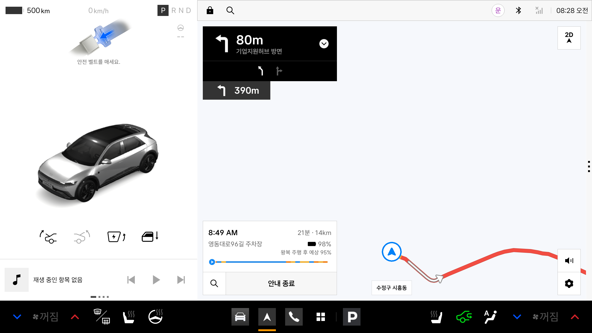
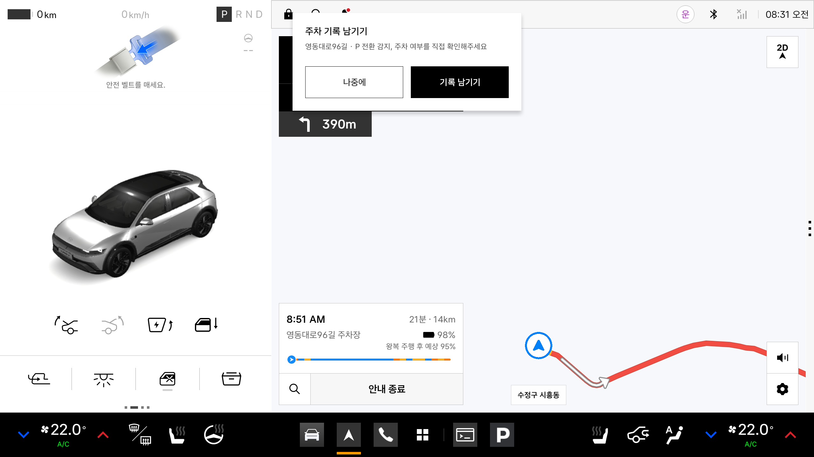
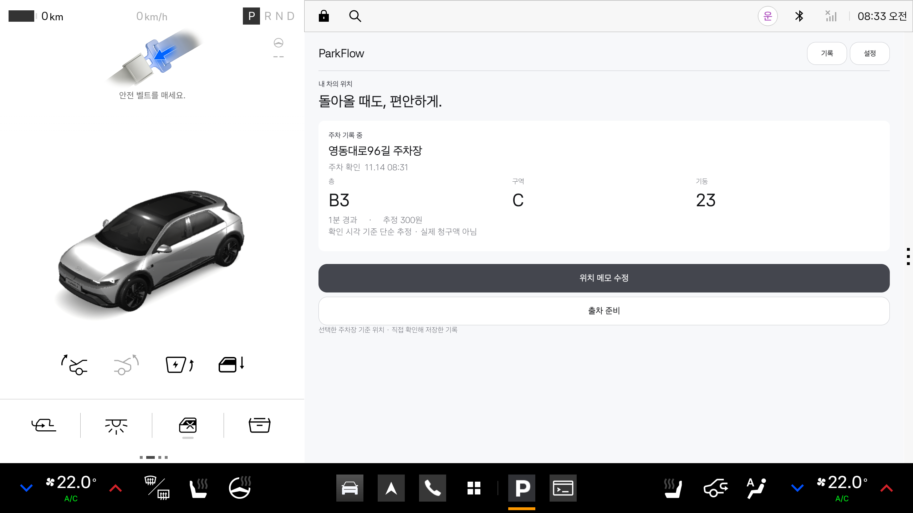

# 제출용 APK 검증 결과

검증일: **2026-11-15 (KST)**. 앱 0.10/code 10, `demo` 변형. 호스트 macOS arm64, JDK 17, Pleos Connect 2.1.0 / Android API 34 / arm64. 에뮬레이터 화면 시각은 호스트와 달라 날짜 증빙으로 사용하지 않습니다.

## 빌드 및 설치

- `./scripts/build-signed.sh demo`: APK 생성, lint, 단위 테스트 통과.
- 단위 테스트 **45개 통과**, 실패·오류·건너뜀 0개.
- Android lint **오류 0개**, 기존 `SetTextI18n` 경고 3개. 전체 다국어 지원을 검증했다는 의미는 아닙니다.
- `apksigner verify`, `zipalign -c 4` 통과. 서명된 APK이며 `debuggable=false`.
- 설치된 `base.apk`를 다시 추출하여 빌드 APK와 SHA-256이 동일함을 확인.
- 외부 서명 설정이 없으면 제출용 빌드 스크립트가 빌드 전에 종료함을 확인. 실제 서명키·비밀번호는 저장소와 제출물에 포함하지 않음.

## 새 clone 빌드

Git 소스를 공백이 있는 새 폴더에 clone하고 `scripts/build.sh`를 실행했습니다. 저장소 밖 부모 디렉터리나 기존 `local.properties` 없이 debug APK 생성, lint 및 단위 테스트 45개가 통과했습니다. 빌드 작업 53개를 모두 실행했습니다. 설치된 JDK/Android SDK와 이미 내려받은 Gradle 의존성 캐시는 재사용했으므로, 완전히 새로운 OS의 도구 설치·최초 네트워크 다운로드를 검증한 것은 아닙니다. 이후 변경은 검증 문서와 원본 라이선스 공백 보존용 Git 속성뿐입니다.

## 실제 UI와 SDK 검증

| 순서 | 확인한 결과 |
| --- | --- |
| 최초 실행 | QR 미리보기 → 내비로 시작하기 → 알림 권한 허용 → 기본 내비로 이동 |
| 목적지 설정 | 기본 내비에서 카페머머 선택, NaviHelper 목적지 이름·좌표 수신 |
| 자동 추천 | 내비가 전면인 상태에서 실제 추천 팝업과 두 버튼 표시를 화면으로 확인 |
| 보조 버튼 | 다른 주차장 보기 → 3개 후보 비교 화면 직접 진입; 이 동작만으로 경로 요청하지 않음 |
| 요금 계산 | 1시간 후보 화면 확인, 2시간 선택 후 SDK 서비스 로그에서 7,200 / 7,200 / 2,400원 재계산 확인 |
| 주차장 선택 | 비교 화면의 이곳으로 안내 → 기본 내비 목적지가 영동대로96길 주차장으로 변경; 목적지 재조회 좌표 일치 |
| 기어 | 공식 Virtual Console의 N → P 입력을 공개 AAOS 콜백 값 1 → 4로 수신 |
| 기록 제안 | 내비 위 기록 팝업의 기록 남기기 → 주차 확인 화면 직접 진입 |
| 저장·복원 | 명시적 주차 확인 → 메모 저장 → 앱 force-stop/재실행 후 B3 / C / 23을 각 필드에 유지 |

이번 실행에서 추천 팝업의 직접 안내 버튼과 기록 팝업의 나중에 버튼은 누르지 않았습니다. 버튼 존재는 확인했고 관련 일회성·만료 로직은 단위 테스트 대상입니다. 이 결과를 모든 버튼·예외·주행 상태의 실기 검증으로 확대 해석하지 않습니다.

## 화면 증거

실제 제출 APK에서 촬영했습니다. 차량 내 수동 위치 메모는 모바일 앱 기능의 증거가 아닙니다. 아래 B3/C/23은 입력·복원 테스트용 문자열이며 해당 노상 주차장의 실제 구조를 뜻하지 않습니다.

## 원본 보존과 제한

기존 AVD는 `-read-only -no-snapshot` 임시 오버레이로 부팅했습니다. 서명이 다른 debug 앱 삭제와 새 APK 설치는 임시 오버레이에서만 수행했습니다. 종료 후 원본 디스크 이미지들의 크기·수정시각이 모두 동일함을 확인했습니다. 기존 앱 기록의 해시도 시작 전에 로컬 증거로 보관했습니다. 원시 로그·기록 파일·기존 개발 이력은 공개 저장소에 넣지 않았습니다.

실차, 이동 중 UI, 앱 마켓 승인, 실제 주차장 입구/빈자리, 모바일 연동·사진 기록·계정·서버·결제는 검증 범위 밖입니다. 영상의 차량/도보/총 이동 시간 비교는 시연용 예시입니다.
