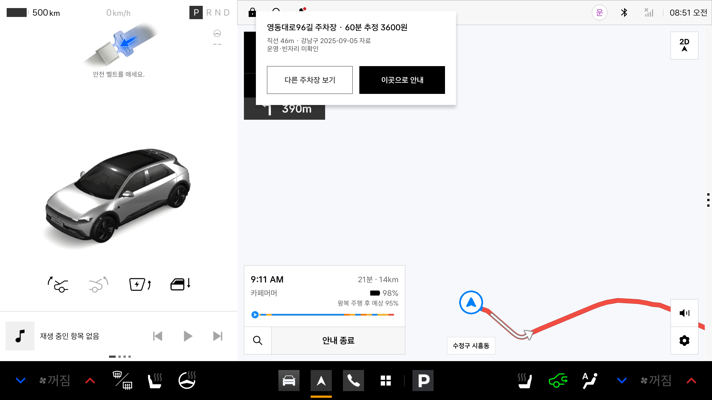
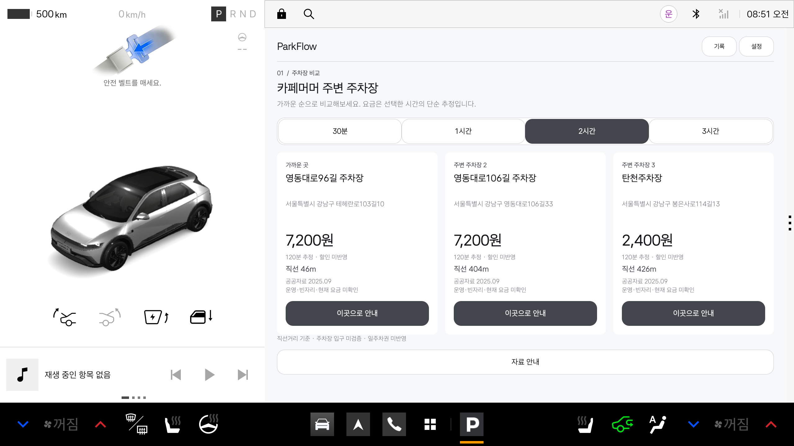
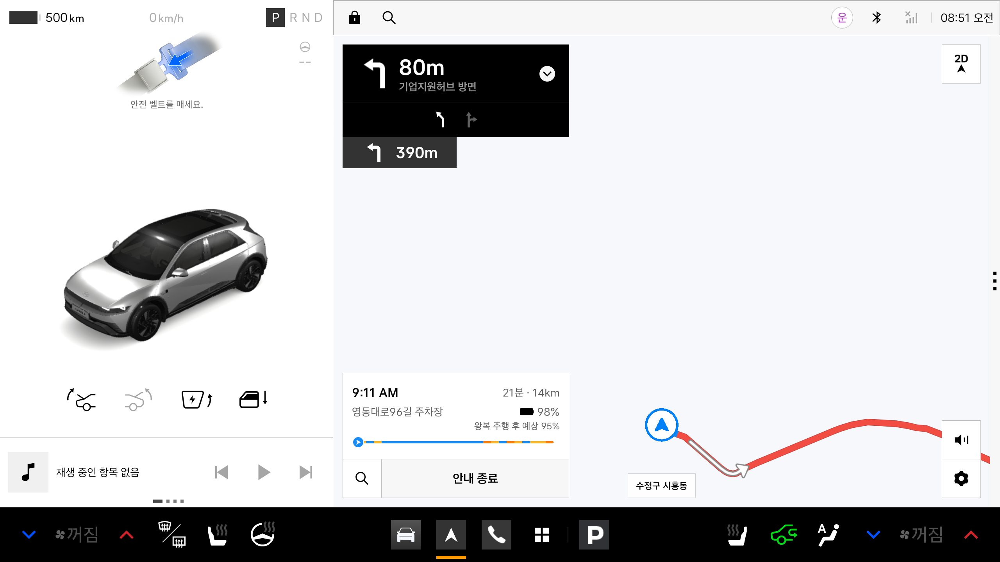
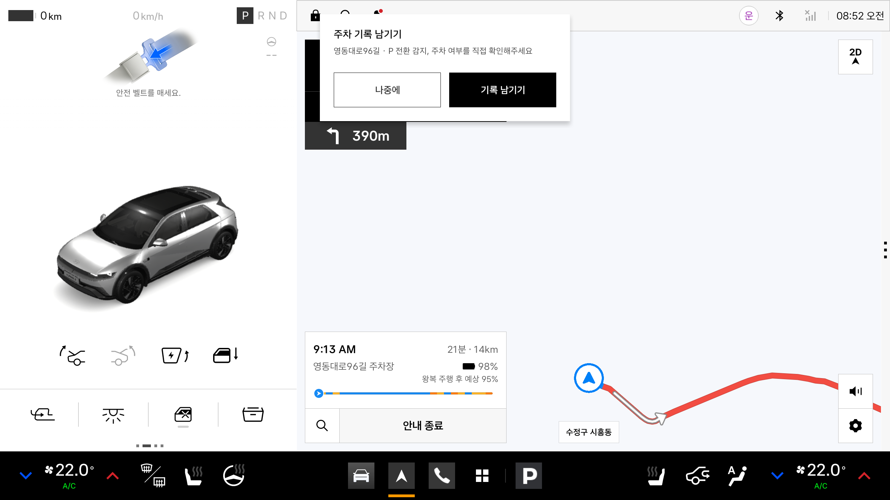
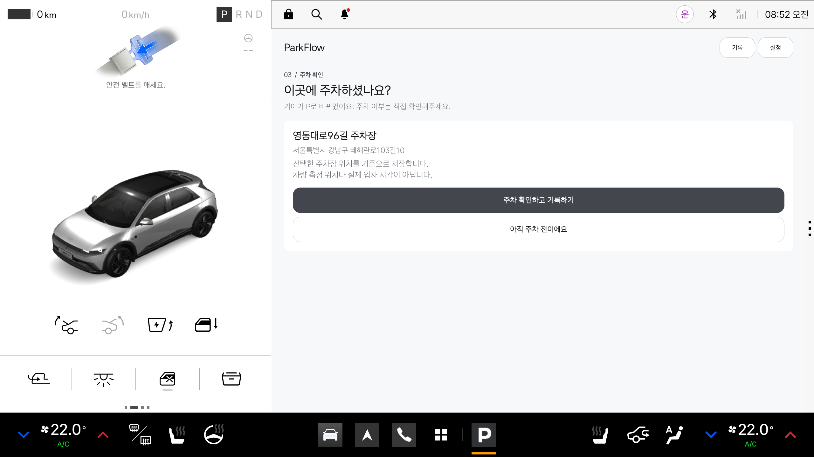
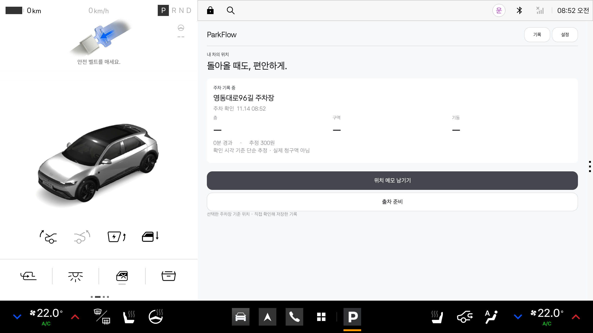

# 0.11 release 제출 APK 검증 결과

검증일: **2026-11-15 KST**. [제출 APK](../apk/클로버_ParkFlow_release.apk)를 생성한 Gradle **release** 변형으로 검증했습니다. 이전 demo 파일의 이름만 변경한 것이 아닙니다.

## 빌드와 파일 일치

- `assembleRelease`, `lintRelease`, `testReleaseUnitTest` 통과.
- 단위 테스트 **45개 통과**, 실패·오류·건너뜀 0개.
- Lint 오류 0개, 기존 문자열 현지화 `SetTextI18n` 경고 3개.
- `apksigner verify`, ZIP 정렬 검사 통과. `BuildConfig.BUILD_TYPE=release`, `DEBUG=false`, version 0.11/code 11.
- 빌드 결과, 에뮬레이터에 설치된 `base.apk`, `apk/` 제출 파일의 SHA-256이 동일합니다.
- `PARKING_NAV_POC=true`로 기존 시연의 알림 동작을 유지합니다. 서명과 release 빌드는 차량 UI 정책 면제나 앱 마켓 승인을 뜻하지 않습니다.

## 테스트 환경

Pleos Connect **2.1.0**, Android API **34**, **arm64-v8a**, 전체 디스플레이 **2560×1440 px / 160 dpi**. `adb shell wm size`, `wm density`로 실측했습니다. 앱은 차량 화면 우측 앱 영역에 표시됩니다. 에뮬레이터 내부 날짜/시각은 호스트와 다르므로 검증일 증거로 사용하지 않습니다.

## 실제 실행 검증

| 흐름 | 확인 결과 |
| --- | --- |
| 신규 설치 | QR 미리보기 → 내비로 시작하기 → 알림 권한 허용 → 기본 내비 |
| 목적지 연동 | 기본 내비에서 카페머머 선택 후 자동 추천 팝업 표시 |
| 비교 진입 | 팝업의 다른 주차장 보기로 비교 화면 직접 진입 |
| 요금 비교 | 2시간 선택 후 7,200 / 7,200 / 2,400원과 주차장 이름·주소 표시를 실제 UI에서 확인 |
| 길 안내 | 비교 화면에서 선택 후 기본 내비의 목적지가 영동대로96길 주차장으로 변경 |
| 기어 신호 | 공식 Virtual Console의 N → P 변경 후 기록 제안 팝업 표시 |
| 기록 확인 | 팝업의 기록 남기기로 주차 확인 화면 직접 진입 |
| 저장·복원 | 주차 확인하고 기록하기 → 메모 나중에 입력 → 앱 force-stop/재실행 후 같은 주차장 기록 복원 |

이번 release 실행에서는 추천 팝업의 직접 안내 버튼, 기록 팝업의 나중에 버튼, 위치 메모 편집을 다시 누르지는 않았습니다. 관련 상태 로직은 단위 테스트와 [이전 0.10 검증](validation-0.10.md)을 구분해 참고합니다. 이전의 새 clone 빌드 결과도 해당 문서에 남겼습니다.

## 실제 release 화면

## 보존과 범위

기존 AVD를 read-only 임시 오버레이로 실행해 서명이 다른 앱의 설치·삭제를 격리했습니다. 종료 후 원본 디스크 이미지의 크기·수정 시각이 모두 동일했습니다. 개인키, 저장 기록, 원시 시스템 로그는 공개하지 않습니다.

실차·이동 중 UI·실시간 주차 운영·빈자리·실제 도착 감지·모바일·QR 계정·서버 동기화·결제는 검증 범위가 아닙니다. 소개 영상의 모바일 화면과 이동 시간 비교는 목표 UX/예시로 표시됩니다.
